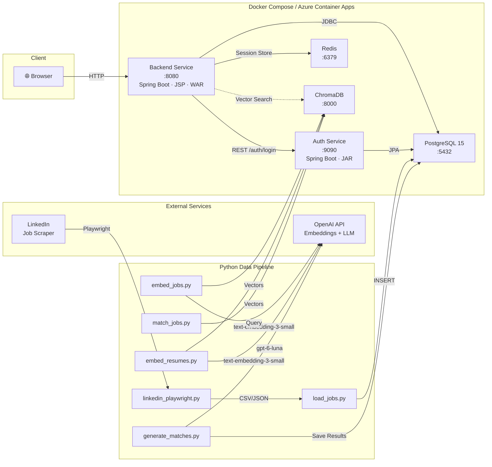
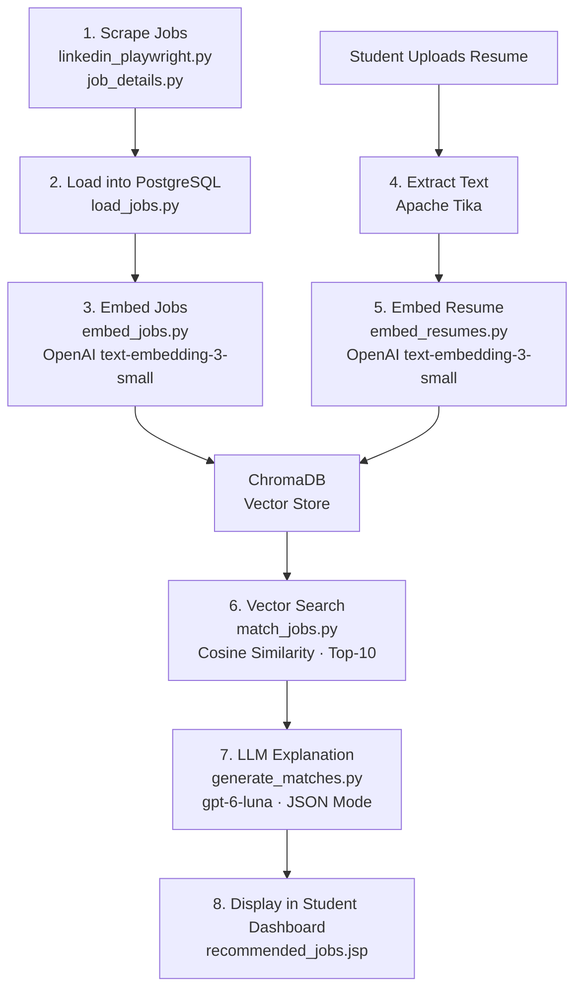
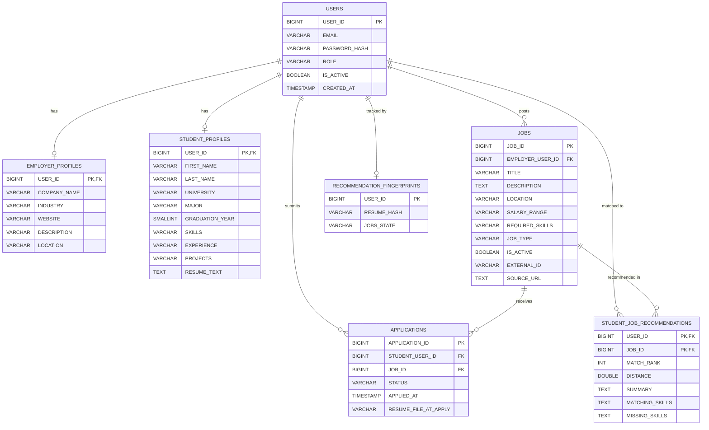
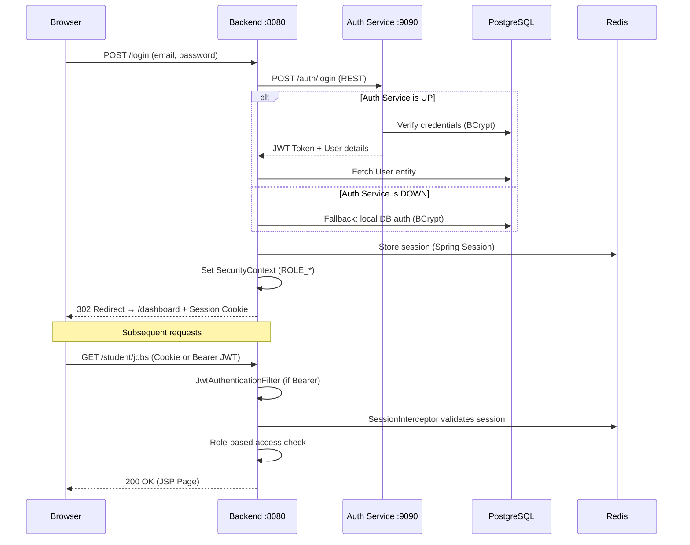
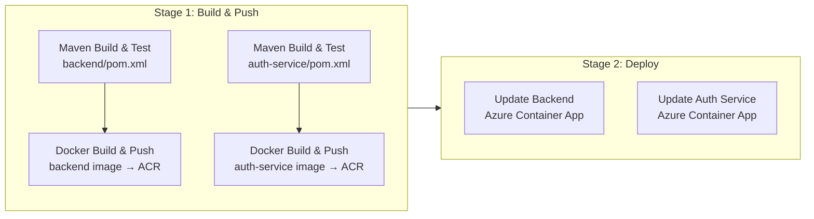

# 🎯 Job Application Portal

A full-stack **Job Application Portal** built with a microservices architecture, featuring an **AI-powered job recommendation engine** that matches students to relevant opportunities using vector embeddings and LLM-based explanations. The platform serves three user roles — **Students**, **Employers**, and **Admins** — each with dedicated dashboards and capabilities.

> Designed, architected, and developed end-to-end — from database schema to CI/CD deployment on Azure.

---

## 📑 Table of Contents

- [Architecture Overview](#architecture-overview)
- [Tech Stack](#tech-stack)
- [Key Features](#key-features)
- [AI / ML Recommendation Pipeline](#ai--ml-recommendation-pipeline)
- [Project Structure](#project-structure)
- [Database Schema](#database-schema)
- [Authentication & Security](#authentication--security)
- [Getting Started](#getting-started)
- [CI/CD Pipeline](#cicd-pipeline)
- [Testing](#testing)
- [Environment Variables](#environment-variables)
- [API Endpoints](#api-endpoints)

---

## Architecture Overview



---

## Tech Stack

| Layer | Technology |
|---|---|
| **Backend** | Java 17 · Spring Boot 3.4.1 · Hibernate ORM · Spring Security · Spring Session |
| **Auth Microservice** | Java 17 · Spring Boot 3.4.1 · Spring Security · OAuth2 Client · Spring Data JPA |
| **Frontend** | JSP (Jakarta Server Pages) · JSTL · Bootstrap · CSS |
| **Database** | PostgreSQL 15 |
| **Session Store** | Redis (via Spring Session + Jedis) |
| **Vector Database** | ChromaDB |
| **AI / Embeddings** | OpenAI `text-embedding-3-small` (1536-dim) |
| **LLM** | OpenAI `gpt-6-luna` (JSON mode) |
| **Data Pipeline** | Python 3.13 · Playwright · psycopg2 · chromadb · openai SDK |
| **Authentication** | JWT (JJWT 0.12.x) · BCrypt · HMAC-SHA256 |
| **Resume Parsing** | Apache Tika 2.9.2 |
| **Containerization** | Docker · Docker Compose |
| **CI/CD** | Azure Pipelines · Azure Container Registry · Azure Container Apps |
| **Observability** | SLF4J + Logback · MDC Trace IDs · Per-request correlation |
| **Build** | Maven · Maven Wrapper |

---

## Key Features

### 🎓 Student Portal
- **Profile Management** — maintain university, skills, experience, projects, and certifications
- **Resume Upload** — upload PDF resumes with automatic text extraction via Apache Tika
- **Job Search & Filtering** — browse all active jobs, filter by title/location/type
- **One-Click Apply / Withdraw** — apply to jobs with resume snapshot; withdraw anytime
- **Application Tracking** — real-time status tracking: `PENDING` → `UNDER_REVIEW` → `ACCEPTED` / `REJECTED`
- **AI-Powered Recommendations** — personalized job matches with match explanations, matching skills, and gap analysis

### 🏢 Employer Portal
- **Job Posting** — create and manage job listings with full details (description, salary, skills, deadline)
- **Applicant Management** — view all applicants per job, download submitted resumes
- **Status Workflow** — transition applicant status through the hiring pipeline with notes

### 🔑 Admin Dashboard
- **Platform Analytics** — aggregate statistics on users, jobs, and applications
- **User Management** — activate/deactivate any user account
- **Data Oversight** — full visibility into platform activity

### 🔒 Authentication & Resilience
- **Dual-Auth Architecture** — dedicated auth microservice with graceful fallback to local DB authentication if the microservice is unreachable
- **JWT Token Flow** — stateless API authentication via signed JWT tokens
- **Session-Based Web Auth** — Redis-backed HTTP sessions for browser-based navigation
- **Role-Based Access Control** — URL-level and interceptor-level enforcement (`STUDENT`, `EMPLOYER`, `ADMIN`)
- **Password Security** — BCrypt hashing for all stored passwords

---

## AI / ML Recommendation Pipeline

The recommendation engine is a **Retrieval-Augmented Generation (RAG)** system that combines vector similarity search with LLM-powered explanations:



### Pipeline Details

| Step | Script | Description |
|---|---|---|
| **Scrape** | `linkedin_playwright.py` | Headless browser scraping of LinkedIn job listings using Playwright |
| **Extract Details** | `job_details.py` | Fetches full job descriptions from individual listing pages |
| **Load** | `load_jobs.py` | Idempotent upsert of scraped jobs into PostgreSQL (`ON CONFLICT` handling) |
| **Embed Jobs** | `embed_jobs.py` | Chunks job descriptions (200 words, 40-word overlap), generates OpenAI embeddings, stores in ChromaDB with content-hash deduplication |
| **Embed Resumes** | `embed_resumes.py` | Chunks resume text (400 words, 80-word overlap), generates embeddings, upserts with change detection via SHA-1 fingerprinting |
| **Match** | `match_jobs.py` | Multi-chunk vector query against ChromaDB, aggregates by minimum distance, returns Top-10 |
| **Explain** | `generate_matches.py` | Single LLM call per student with structured JSON output — per-job summary, matching skills, and skill gaps. Results are cached and reused when resume/jobs haven't changed |

### Smart Caching

The system avoids redundant API calls through a **fingerprinting mechanism**:
- A SHA-1 hash of the resume text and a composite `count|max_id|max_created_at` jobs state are stored in `recommendation_fingerprints`
- Recommendations are regenerated only when the resume changes or new jobs are added
- LLM explanations for unchanged job-resume pairs are reused across runs

---

## Project Structure

```
WebDevFinalProjectwithCICD/
├── backend/                          # Main portal service (Spring Boot WAR)
│   ├── Dockerfile
│   ├── pom.xml
│   └── src/
│       ├── main/
│       │   ├── java/com/job/portal/
│       │   │   ├── config/           # SecurityConfig, RedisConfig, JwtFilter, TraceIdFilter
│       │   │   ├── controller/       # AuthController, StudentController, EmployerController, AdminController
│       │   │   ├── dao/              # DAO interfaces + Hibernate implementations
│       │   │   ├── dto/              # RecommendationDTO, JobMatchDTO
│       │   │   ├── exception/        # GlobalExceptionHandler, custom exceptions
│       │   │   ├── interceptor/      # SessionInterceptor (auth + RBAC)
│       │   │   ├── model/            # User, Job, Application, StudentProfile, EmployerProfile
│       │   │   ├── service/          # Service interfaces + implementations
│       │   │   └── util/             # FileStorageUtil, InputValidator, ResumeTextExtractor, EmbeddingUtil
│       │   ├── resources/
│       │   │   ├── application.properties
│       │   │   ├── application-docker.properties
│       │   │   ├── schema.sql        # Full DDL (idempotent)
│       │   │   ├── data.sql          # Seed users
│       │   │   ├── seed_jobs_data.sql # Seed job postings
│       │   │   └── logback-spring.xml # Structured logging with trace IDs
│       │   └── webapp/WEB-INF/jsp/   # JSP views (student/, employer/, admin/, common/)
│       └── test/                     # Unit tests (MockMvc, Mockito)
│
├── auth-service/                     # Authentication microservice (Spring Boot JAR)
│   ├── Dockerfile
│   ├── pom.xml
│   └── src/
│       └── main/java/com/job/portal/auth/
│           ├── config/               # SecurityConfig, TraceIdFilter
│           ├── controller/           # AuthController (REST), JwtTestController
│           ├── jwt/                  # JwtUtil (generate, validate, extract claims)
│           ├── model/                # User entity, LoginRequest/LoginResponse DTOs
│           ├── repository/           # UserRepository (Spring Data JPA)
│           ├── service/              # AuthService (BCrypt verification + JWT issuance)
│           └── exception/            # AuthException, GlobalExceptionHandler
│
├── job-scraper/                      # Python data & AI pipeline
│   ├── linkedin_playwright.py        # LinkedIn job scraper (Playwright)
│   ├── job_details.py                # Job detail extractor
│   ├── load_jobs.py                  # PostgreSQL job loader
│   ├── embed_jobs.py                 # Job embedding pipeline → ChromaDB
│   ├── embed_resumes.py              # Resume embedding pipeline → ChromaDB
│   ├── match_jobs.py                 # Vector similarity search
│   ├── generate_matches.py           # LLM-based match explanation (RAG)
│   ├── db.py                         # Shared PostgreSQL connection utility
│   └── logger_setup.py               # Structured logging for Python scripts
│
├── docker-compose.yml                # Full local stack (Postgres, Redis, ChromaDB, Backend, Auth)
├── azure-pipelines.yml               # CI/CD: Build → Test → Docker Push → Deploy to Azure Container Apps
├── seed_jobs_data.sql                # Job seed data
└── .gitignore
```

---

## Database Schema



---

## Authentication & Security

The system implements a **layered security architecture** with dual authentication paths:



### Security Layers

| Layer | Implementation |
|---|---|
| **Password Hashing** | BCrypt via `PasswordEncoder` bean |
| **JWT Tokens** | HMAC-SHA256 signed, 1-hour expiry, carries `email`, `role`, `userId` |
| **Session Management** | Redis-backed via `@EnableRedisHttpSession`, session cookie in browser |
| **Request Filtering** | `JwtAuthenticationFilter` → Spring Security `SecurityFilterChain` → `SessionInterceptor` |
| **RBAC** | URL patterns: `/admin/**` → `ROLE_ADMIN`, `/student/**` → `ROLE_STUDENT`, `/employer/**` → `ROLE_EMPLOYER` |
| **Observability** | `TraceIdFilter` injects a UUID `X-Trace-Id` into every request via MDC for log correlation |

---

## Getting Started

### Prerequisites

- **Java 17** (JDK)
- **Maven 3.9+** (or use the included `mvnw` wrapper)
- **Docker** & **Docker Compose**
- **Python 3.11+** (for the AI pipeline, optional)
- **OpenAI API Key** (for embeddings and LLM recommendations, optional)

### Run Locally with Docker Compose

```bash
# 1. Clone the repository
git clone <repository-url>
cd WebDevFinalProjectwithCICD

# 2. Build the Maven artifacts
cd backend && mvn clean package -DskipTests && cd ..
cd auth-service && mvn clean package -DskipTests && cd ..

# 3. Start the full stack
docker compose up --build
```

| Service | URL |
|---|---|
| **Main Portal** | http://localhost:8080 |
| **Auth Service** | http://localhost:9090 |
| **ChromaDB** | http://localhost:8000 |
| **PostgreSQL** | `localhost:5432` (DB: `jobportal`) |
| **Redis** | `localhost:6379` |

### Rebuild After Code Changes

```bash
# Rebuild Java artifacts
cd backend && mvn clean package -DskipTests && cd ..
cd auth-service && mvn clean package -DskipTests && cd ..

# Rebuild Docker images and restart
docker compose down
docker compose build --no-cache
docker compose up
```

### Run the AI Recommendation Pipeline (Optional)

```bash
cd job-scraper

# Set up Python environment
python -m venv .venv && source .venv/bin/activate
pip install -r requirements.txt  # or install: openai chromadb psycopg2 python-dotenv playwright

# Configure environment
cp .env.example .env  # Add OPENAI_API_KEY, PGPASSWORD, etc.

# Run the pipeline
python linkedin_playwright.py     # 1. Scrape jobs from LinkedIn
python job_details.py             # 2. Fetch full job descriptions
python load_jobs.py               # 3. Load jobs into PostgreSQL
python embed_jobs.py              # 4. Generate and store job embeddings
python embed_resumes.py           # 5. Generate and store resume embeddings
python generate_matches.py <uid>  # 6. Generate AI recommendations for a user
```

---

## CI/CD Pipeline

The project uses **Azure Pipelines** with a two-stage CI/CD workflow:



| Component | Detail |
|---|---|
| **Trigger** | Push to `main` branch |
| **Registry** | Azure Container Registry (`jobportal.azurecr.io`) |
| **Target** | Azure Container Apps (serverless containers) |
| **Tests** | Maven Surefire runs JUnit tests in the Build stage; build fails if tests fail (`-DfailIfNoTests=true`) |
| **Tagging** | Images tagged with `Build.BuildId` and `latest` |

---

## Testing

The project includes **unit and integration tests** using JUnit 5, MockMvc, and Mockito:

```bash
# Run all tests
cd backend && mvn test
cd auth-service && mvn test
```

### Test Coverage Highlights

| Test | Validates |
|---|---|
| `AuthControllerTest` | Microservice fallback to local DB, error handling on wrong credentials |
| `ApplicationApiControllerTest` | Application API endpoints, status transitions |
| `StudentControllerTest` | Student dashboard, job views, profile operations |
| `SimpleValidationTests` | Input validation logic |
| `AuthServiceTest` | Auth microservice login, JWT generation, BCrypt verification |

Tests use `@WebMvcTest` for slice testing (no DB required) and `@MockitoBean` for dependency isolation.

---

## Environment Variables

### Backend Service

| Variable | Description | Default |
|---|---|---|
| `SPRING_PROFILES_ACTIVE` | Active Spring profile | `docker` |
| `SPRING_DATASOURCE_URL` | PostgreSQL JDBC URL | `jdbc:postgresql://postgres-db:5432/jobportal` |
| `SPRING_DATASOURCE_USERNAME` | DB username | `postgres` |
| `SPRING_DATASOURCE_PASSWORD` | DB password | — |
| `SPRING_DATA_REDIS_HOST` | Redis hostname | `redis` |
| `AUTH_SERVICE_URL` | Auth microservice URL | `http://auth-service:9090` |
| `RESUME_UPLOAD_DIR` | Resume file storage path | `/app/uploads/resumes` |
| `CHROMA_URL` | ChromaDB URL | `http://chromadb:8000` |
| `OPENAI_API_KEY` | OpenAI API key (for embeddings) | — |

### Python Pipeline (`job-scraper/.env`)

| Variable | Description |
|---|---|
| `OPENAI_API_KEY` | OpenAI API key |
| `PGHOST` | PostgreSQL host |
| `PGPORT` | PostgreSQL port |
| `PGDATABASE` | Database name |
| `PGUSER` | Database user |
| `PGPASSWORD` | Database password |
| `CHROMA_HOST` | ChromaDB host |
| `CHROMA_PORT` | ChromaDB port |
| `EMPLOYER_USER_ID` | User ID to associate scraped jobs with |

---

## API Endpoints

### Auth Service (`:9090`)

| Method | Endpoint | Description |
|---|---|---|
| `POST` | `/auth/login` | Authenticate and receive JWT token |

### Backend Service (`:8080`)

| Method | Endpoint | Role | Description |
|---|---|---|---|
| `GET` | `/` | Public | Login page |
| `POST` | `/login` | Public | Form login (microservice + fallback) |
| `POST` | `/register` | Public | New user registration |
| `POST` | `/forgot-password` | Public | Password reset |
| `GET` | `/ping` | Public | Health check |
| `GET` | `/dashboard` | Authenticated | Role-based dashboard redirect |
| `GET` | `/student/jobs` | Student | Browse all jobs |
| `GET` | `/student/jobs/{id}` | Student | Job detail view |
| `POST` | `/student/apply/{id}` | Student | Apply to a job |
| `GET` | `/student/profile` | Student | View/edit profile |
| `GET` | `/student/recommendations` | Student | AI-powered job recommendations |
| `GET` | `/employer/dashboard` | Employer | Employer dashboard |
| `POST` | `/employer/post-job` | Employer | Create a new job posting |
| `GET` | `/employer/applications` | Employer | View applicants |
| `GET` | `/admin/dashboard` | Admin | Platform statistics |
| `GET` | `/admin/users` | Admin | User management |

---

## License

This project was developed as an academic capstone project.

